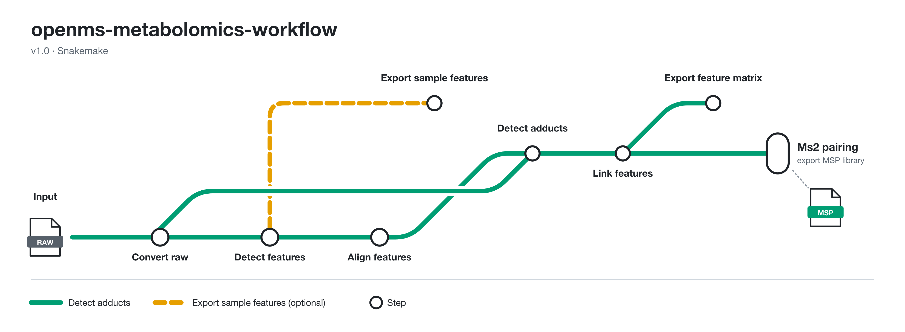

# openms-metabolomics-workflow

A Snakemake workflow for untargeted LC-MS metabolomics built on [pyOpenMS](https://pyopenms.readthedocs.io/). It takes vendor raw files and produces a consensus feature matrix across samples and an MSP library of MS2 spectra for those features.



## Steps

1. **Convert raw**: converts Thermo `.raw` files to `.mzML` with ProteoWizard `msconvert` (run in Docker).
2. **Detect features**: per-sample feature finding (MassTraceDetection → ElutionPeakDetection → FeatureFindingMetabo).
3. **Export sample features**: writes each sample's features to a TSV.
4. **Align features**: aligns retention times to a reference sample (pose clustering).
5. **Detect adducts**: groups adducts per sample (MetaboliteFeatureDeconvolution).
6. **Link features**: links features across samples into a consensus map.
7. **Export feature matrix**: writes the consensus features × samples intensity table.
8. **MS2 pairing**: assigns each consensus feature its best-matching MS2 spectrum and exports an MSP library.

## Usage

Samples are listed in `config/samples.tsv`. All parameters are in `config/config.yaml`.

```bash
pixi install
pixi run snakemake --cores all
```

Main outputs are in `results/final/`: the feature matrix (`feature_matrix.tsv`) and the MS2 library (`consensus_ms2.msp`).
